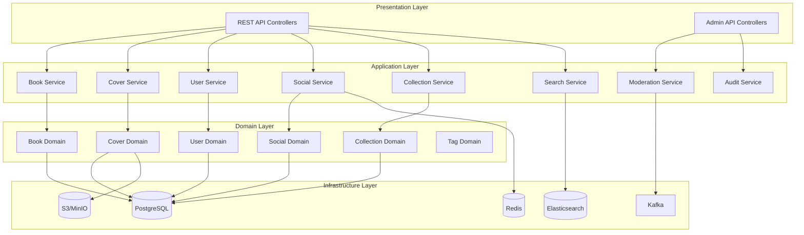

# Design Document: Book Cover Archive

## Overview

북커버 디자인 아카이브는 Spring Boot 기반의 백엔드 시스템으로, 원서와 번역서의 북커버를 수집, 비교, 공유할 수 있는 플랫폼입니다. 시스템은 확장성을 고려하여 향후 영화 포스터 등 다른 미디어 유형으로 확장 가능하도록 설계됩니다.

### 기술 스택

- **Backend**: Spring Boot 3.x (Java 21)
- **Database**: PostgreSQL (관계형 데이터), Redis (캐싱, 레이트 리밋)
- **Search**: Elasticsearch (전문 검색)
- **Storage**: AWS S3 또는 MinIO (이미지 저장)
- **Message Queue**: Apache Kafka (비동기 처리)
- **Authentication**: Spring Security + JWT
- **Build Tool**: Gradle (Groovy DSL)

## Architecture

시스템은 레이어드 아키텍처와 도메인 주도 설계(DDD)를 결합하여 구성됩니다.



## Components and Interfaces

### 1. 도메인 모델

#### 1.1 Media (추상 베이스)

확장성을 위한 미디어 추상 클래스:

```java
@Entity
@Inheritance(strategy = InheritanceType.JOINED)
@DiscriminatorColumn(name = "media_type")
public abstract class Media {
    @Id
    @GeneratedValue(strategy = GenerationType.UUID)
    private UUID id;

    @Column(nullable = false)
    private String title;

    @Column(nullable = false)
    private String countryCode;  // ISO 3166-1

    @Column(nullable = false)
    private String languageCode;  // ISO 639-1

    @Column(nullable = false)
    private Integer year;

    @Enumerated(EnumType.STRING)
    private ContentStatus status = ContentStatus.PUBLISHED;

    @ManyToOne(fetch = FetchType.LAZY)
    private User createdBy;

    private Instant createdAt = Instant.now();
    private Instant updatedAt = Instant.now();

    // Getters and Setters
}

public enum ContentStatus {
    DRAFT, PUBLISHED, HIDDEN, DELETED
}
```

#### 1.2 OriginalBook (원서)

```java
@Entity
@DiscriminatorValue("BOOK_ORIGINAL")
public class OriginalBook extends Media {
    @Column(nullable = false)
    private String originalTitle;

    @Column(nullable = false)
    private String genre;

    @Column(unique = true)
    private String isbn;

    @ManyToOne(fetch = FetchType.LAZY)
    private Author author;

    @ManyToOne(fetch = FetchType.LAZY)
    private Publisher publisher;

    @ManyToOne(fetch = FetchType.LAZY)
    private Designer designer;

    private String edition;

    @ManyToOne(fetch = FetchType.LAZY)
    private Work work;  // 같은 작품 그룹화

    @OneToMany(mappedBy = "originalBook", cascade = CascadeType.ALL)
    private List<TranslatedBook> translations = new ArrayList<>();

    @OneToOne(cascade = CascadeType.ALL, optional = false)
    private BookCover frontCover;

    @OneToOne(cascade = CascadeType.ALL)
    private BookCover backCover;

    // Getters and Setters
}
```

#### 1.3 TranslatedBook (번역서)

```java
@Entity
@DiscriminatorValue("BOOK_TRANSLATED")
public class TranslatedBook extends Media {
    @Column(unique = true)
    private String isbn;

    @ManyToOne(fetch = FetchType.LAZY, optional = false)
    private OriginalBook originalBook;

    @ManyToOne(fetch = FetchType.LAZY)
    private Author author;

    @ManyToOne(fetch = FetchType.LAZY)
    private Translator translator;

    @ManyToOne(fetch = FetchType.LAZY)
    private Publisher publisher;

    private String edition;

    @OneToOne(cascade = CascadeType.ALL, optional = false)
    private BookCover frontCover;

    @OneToOne(cascade = CascadeType.ALL)
    private BookCover backCover;

    // Getters and Setters
}
```

#### 1.4 BookCover (북커버)

```java
@Entity
public class BookCover {
    @Id
    @GeneratedValue(strategy = GenerationType.UUID)
    private UUID id;

    @Column(nullable = false)
    private String imageUrl;

    @Column(nullable = false)
    private String thumbnailUrl;

    @Column(nullable = false)
    private String originalFileName;

    private Integer width;
    private Integer height;
    private Long fileSize;

    @Enumerated(EnumType.STRING)
    private CoverType coverType;

    @Enumerated(EnumType.STRING)
    private ImageSource imageSource;

    private String sourceUrl;

    @ManyToMany
    @JoinTable(name = "cover_tags")
    private Set<DesignTag> tags = new HashSet<>();

    private String dominantColor;  // HEX color

    @Enumerated(EnumType.STRING)
    private CoverLayout layout;

    private Integer likeCount = 0;
    private Integer commentCount = 0;

    private Instant createdAt = Instant.now();

    // Getters and Setters
}

public enum CoverType { FRONT, BACK }
public enum ImageSource { SCAN, PHOTO, LINK, OTHER }
public enum CoverLayout { CENTER, LEFT, RIGHT, FULL_BLEED, MINIMAL }
```

#### 1.5 Redesign (리디자인)

```java
@Entity
public class Redesign {
    @Id
    @GeneratedValue(strategy = GenerationType.UUID)
    private UUID id;

    @Column(nullable = false)
    private String imageUrl;

    @Column(nullable = false)
    private String thumbnailUrl;

    @Column(nullable = false, length = 2000)
    private String description;

    @ManyToOne(fetch = FetchType.LAZY)
    private OriginalBook originalBook;

    @ManyToOne(fetch = FetchType.LAZY)
    private TranslatedBook translatedBook;

    @ManyToOne(fetch = FetchType.LAZY, optional = false)
    private User createdBy;

    @ManyToMany
    @JoinTable(name = "redesign_tags")
    private Set<DesignTag> tags = new HashSet<>();

    @Enumerated(EnumType.STRING)
    private ContentStatus status = ContentStatus.PUBLISHED;

    private Integer likeCount = 0;
    private Integer commentCount = 0;

    private Instant createdAt = Instant.now();
    private Instant updatedAt = Instant.now();

    // Getters and Setters
}
```

#### 1.6 User (회원)

```java
@Entity
@Table(name = "users")
public class User {
    @Id
    @GeneratedValue(strategy = GenerationType.UUID)
    private UUID id;

    @Column(nullable = false, unique = true)
    private String email;

    @Column(nullable = false)
    private String displayName;

    @Column(nullable = false)
    private String passwordHash;

    @Enumerated(EnumType.STRING)
    @Column(nullable = false)
    private UserRole role;

    @Enumerated(EnumType.STRING)
    private UserTitle title = UserTitle.MEMBER;

    private String websiteUrl;
    private String portfolioUrl;

    @ElementCollection
    @CollectionTable(name = "user_sns_accounts")
    @MapKeyColumn(name = "platform")
    @Column(name = "account")
    private Map<String, String> snsAccounts = new HashMap<>();

    private Integer contributionCount = 0;

    @Enumerated(EnumType.STRING)
    private UserStatus status = UserStatus.ACTIVE;

    private Boolean reportRestricted = false;
    private Instant suspendedUntil;

    private Instant createdAt = Instant.now();
    private Instant lastLoginAt;

    // Getters and Setters
}

public enum UserRole { PUBLISHER, AUTHOR, DESIGNER, MEMBER, ADMIN }
public enum UserTitle { MEMBER, CONTRIBUTOR }
public enum UserStatus { ACTIVE, SUSPENDED, DELETED }
```

#### 1.7 Collection (컬렉션)

```java
@Entity
public class Collection {
    @Id
    @GeneratedValue(strategy = GenerationType.UUID)
    private UUID id;

    @Column(nullable = false)
    private String name;

    private String description;

    @Enumerated(EnumType.STRING)
    private CollectionVisibility visibility = CollectionVisibility.PRIVATE;

    @Column(unique = true)
    private String shareToken = UUID.randomUUID().toString();

    @ManyToOne(fetch = FetchType.LAZY, optional = false)
    private User owner;

    @OneToMany(mappedBy = "collection", cascade = CascadeType.ALL, orphanRemoval = true)
    private List<CollectionItem> items = new ArrayList<>();

    private Instant createdAt = Instant.now();
    private Instant updatedAt = Instant.now();

    // Getters and Setters
}

public enum CollectionVisibility { PRIVATE, PUBLIC, LINK_ONLY }

@Entity
public class CollectionItem {
    @Id
    @GeneratedValue(strategy = GenerationType.UUID)
    private UUID id;

    @ManyToOne(fetch = FetchType.LAZY, optional = false)
    private Collection collection;

    @Enumerated(EnumType.STRING)
    private CollectionItemType itemType;

    private UUID itemId;

    private Instant addedAt = Instant.now();

    // Getters and Setters
}

public enum CollectionItemType { ORIGINAL_COVER, TRANSLATED_COVER, REDESIGN }
```

#### 1.8 Social (좋아요, 댓글)

```java
@Entity
@Table(uniqueConstraints = @UniqueConstraint(columnNames = {"user_id", "target_type", "target_id"}))
public class Like {
    @Id
    @GeneratedValue(strategy = GenerationType.UUID)
    private UUID id;

    @ManyToOne(fetch = FetchType.LAZY, optional = false)
    private User user;

    @Enumerated(EnumType.STRING)
    private LikeTargetType targetType;

    private UUID targetId;

    private Instant createdAt = Instant.now();

    // Getters and Setters
}

public enum LikeTargetType { ORIGINAL_COVER, TRANSLATED_COVER, REDESIGN }

@Entity
public class Comment {
    @Id
    @GeneratedValue(strategy = GenerationType.UUID)
    private UUID id;

    @Column(nullable = false, length = 1000)
    private String content;

    @ManyToOne(fetch = FetchType.LAZY, optional = false)
    private User author;

    @Enumerated(EnumType.STRING)
    private CommentTargetType targetType;

    private UUID targetId;

    @Enumerated(EnumType.STRING)
    private ContentStatus status = ContentStatus.PUBLISHED;

    private Instant createdAt = Instant.now();
    private Instant updatedAt = Instant.now();

    // Getters and Setters
}

public enum CommentTargetType { ORIGINAL_COVER, TRANSLATED_COVER, REDESIGN }
```

#### 1.9 DesignTag (디자인 태그)

```java
@Entity
public class DesignTag {
    @Id
    @GeneratedValue(strategy = GenerationType.UUID)
    private UUID id;

    @Column(nullable = false, unique = true)
    private String name;

    @Enumerated(EnumType.STRING)
    private TagCategory category;

    private Integer usageCount = 0;

    private Boolean approved = true;

    // Getters and Setters
}

public enum TagCategory { STYLE, COLOR, LAYOUT, TYPOGRAPHY, ILLUSTRATION }
```

#### 1.10 Report (신고)

```java
@Entity
public class Report {
    @Id
    @GeneratedValue(strategy = GenerationType.UUID)
    private UUID id;

    @ManyToOne(fetch = FetchType.LAZY, optional = false)
    private User reporter;

    @Enumerated(EnumType.STRING)
    private ReportTargetType targetType;

    private UUID targetId;

    @Enumerated(EnumType.STRING)
    private ReportReason reason;

    private String description;

    @Enumerated(EnumType.STRING)
    private ReportStatus status = ReportStatus.PENDING;

    @ManyToOne(fetch = FetchType.LAZY)
    private User reviewedBy;

    private String reviewNote;
    private Instant reviewedAt;

    private Instant createdAt = Instant.now();

    // Getters and Setters
}

public enum ReportTargetType { ORIGINAL_BOOK, TRANSLATED_BOOK, REDESIGN, COMMENT }
public enum ReportReason { INAPPROPRIATE, COPYRIGHT, SPAM, WRONG_INFO, OTHER }
public enum ReportStatus { PENDING, APPROVED, REJECTED }
```

#### 1.11 AuditLog (감사 로그)

```java
@Entity
public class AuditLog {
    @Id
    @GeneratedValue(strategy = GenerationType.UUID)
    private UUID id;

    @Enumerated(EnumType.STRING)
    private AuditAction action;

    @Enumerated(EnumType.STRING)
    private AuditEntityType entityType;

    private UUID entityId;

    @ManyToOne(fetch = FetchType.LAZY, optional = false)
    private User performedBy;

    @Column(columnDefinition = "jsonb")
    private String previousValue;

    @Column(columnDefinition = "jsonb")
    private String newValue;

    private Instant createdAt = Instant.now();

    // Getters and Setters
}

public enum AuditAction { CREATE, UPDATE, DELETE, MERGE, SPLIT, STATUS_CHANGE }
public enum AuditEntityType { ORIGINAL_BOOK, TRANSLATED_BOOK, REDESIGN, USER, COLLECTION, AUTHOR, PUBLISHER, DESIGNER }
```


### 2. 서비스 인터페이스

#### 2.1 BookService

```java
public interface BookService {
    // 원서 관리
    OriginalBook createOriginalBook(CreateOriginalBookRequest request);
    OriginalBook updateOriginalBook(UUID id, UpdateOriginalBookRequest request);
    Optional<OriginalBook> getOriginalBook(UUID id);
    void deleteOriginalBook(UUID id);

    // 번역서 관리
    TranslatedBook createTranslatedBook(UUID originalBookId, CreateTranslatedBookRequest request);
    TranslatedBook updateTranslatedBook(UUID id, UpdateTranslatedBookRequest request);
    Optional<TranslatedBook> getTranslatedBook(UUID id);
    void deleteTranslatedBook(UUID id);

    // 조회
    List<TranslatedBook> getTranslationsByOriginalBook(UUID originalBookId);
    Page<Media> getBooksByAuthor(UUID authorId, Pageable pageable);
    Page<Media> getBooksByPublisher(UUID publisherId, Pageable pageable);
    Page<Media> getBooksByDesigner(UUID designerId, Pageable pageable);

    // 중복 검사
    List<Media> findDuplicatesByIsbn(String isbn);
    List<Media> findSimilarBooks(String title, String authorName, int year);
}
```

#### 2.2 RedesignService

```java
public interface RedesignService {
    Redesign createRedesign(CreateRedesignRequest request);
    Redesign updateRedesign(UUID id, UpdateRedesignRequest request);
    Optional<Redesign> getRedesign(UUID id);
    void deleteRedesign(UUID id);

    Page<Redesign> getRedesignsByOriginalBook(UUID originalBookId, Pageable pageable);
    Page<Redesign> getRedesignsByTranslatedBook(UUID translatedBookId, Pageable pageable);
    Page<Redesign> getRedesignsByUser(UUID userId, Pageable pageable);
}
```

#### 2.3 SocialService

```java
public interface SocialService {
    // 좋아요
    boolean toggleLike(UUID userId, LikeTargetType targetType, UUID targetId);
    int getLikeCount(LikeTargetType targetType, UUID targetId);
    boolean isLikedByUser(UUID userId, LikeTargetType targetType, UUID targetId);

    // 댓글
    Comment createComment(CreateCommentRequest request);
    Comment updateComment(UUID id, String content);
    void deleteComment(UUID id);
    Page<Comment> getComments(CommentTargetType targetType, UUID targetId, Pageable pageable);
}
```

#### 2.4 CollectionService

```java
public interface CollectionService {
    Collection createCollection(CreateCollectionRequest request);
    Collection updateCollection(UUID id, UpdateCollectionRequest request);
    void deleteCollection(UUID id);
    Optional<Collection> getCollection(UUID id);
    Optional<Collection> getCollectionByShareToken(String token);

    void addItem(UUID collectionId, CollectionItemType itemType, UUID itemId);
    void removeItem(UUID collectionId, UUID itemId);

    Page<Collection> getUserCollections(UUID userId, Pageable pageable);
    Page<Collection> getPublicCollections(Pageable pageable);
    Collection duplicateCollection(UUID collectionId, UUID newOwnerId);
}
```

#### 2.5 SearchService

```java
public interface SearchService {
    SearchResult search(String query, SearchFilters filters, Pageable pageable);
    Page<Media> browseByCountry(String countryCode, Pageable pageable);
    Page<Media> browseByYear(int year, Pageable pageable);
    Page<Media> browseByGenre(String genre, Pageable pageable);
    Page<BookCover> browseByTag(UUID tagId, Pageable pageable);

    void reindexAll();
    void indexBook(UUID bookId);
    void removeFromIndex(UUID bookId);
}

public record SearchFilters(
    String countryCode,
    String languageCode,
    Integer yearFrom,
    Integer yearTo,
    String genre,
    UUID publisherId,
    List<UUID> tags,
    SortOption sortBy
) {
    public SearchFilters {
        if (sortBy == null) sortBy = SortOption.RELEVANCE;
    }
}

public enum SortOption { RELEVANCE, LIKES, NEWEST, YEAR_ASC, YEAR_DESC }
```

#### 2.6 ModerationService

```java
public interface ModerationService {
    // 신고 관리
    Report createReport(CreateReportRequest request);
    Page<Report> getReportQueue(Pageable pageable);
    void reviewReport(UUID reportId, ReportDecision decision, String note);

    // 콘텐츠 관리
    void hideContent(ReportTargetType targetType, UUID targetId, String reason);
    void restoreContent(ReportTargetType targetType, UUID targetId);
    void deleteContent(ReportTargetType targetType, UUID targetId, String reason);

    // 사용자 관리
    void suspendUser(UUID userId, Duration duration, String reason);
    void restrictReporting(UUID userId);

    // 중복 관리
    Page<DuplicateSuggestion> getDuplicateSuggestions(Pageable pageable);
    void mergeEntities(UUID sourceId, UUID targetId, AuditEntityType entityType);
}

public record ReportDecision(
    ReportStatus status,
    ModerationAction action
) {}

public enum ModerationAction { HIDE, DELETE, WARN_USER, SUSPEND_USER }
```

#### 2.7 ImageService

```java
public interface ImageService {
    ImageUploadResult uploadImage(MultipartFile file, ImageType type);
    ImageValidationResult validateImage(MultipartFile file);
    String generateThumbnail(String imageUrl);
    String extractDominantColor(String imageUrl);
    void deleteImage(String imageUrl);
}

public record ImageUploadResult(
    String originalUrl,
    String thumbnailUrl,
    int width,
    int height,
    long fileSize
) {}

public record ImageValidationResult(
    boolean valid,
    List<String> errors
) {}

public enum ImageType { COVER, REDESIGN, PROFILE }
```

#### 2.8 RateLimitService

```java
public interface RateLimitService {
    RateLimitResult checkLimit(UUID userId, RateLimitAction action);
    void recordAction(UUID userId, RateLimitAction action);
    boolean isUserRestricted(UUID userId);
}

public enum RateLimitAction {
    UPLOAD, COMMENT, LIKE, REPORT
}

public record RateLimitResult(
    boolean allowed,
    int remainingAttempts,
    Instant resetTime
) {}
```

## Data Models

### API Request/Response DTOs

```java
// 원서 등록 요청
public record CreateOriginalBookRequest(
    String title,
    String originalTitle,
    String countryCode,
    String languageCode,
    int year,
    String genre,
    String isbn,
    UUID authorId,
    String authorName,
    UUID publisherId,
    String publisherName,
    UUID designerId,
    String designerName,
    String edition,
    MultipartFile frontCover,
    MultipartFile backCover,
    ImageSource imageSource,
    String sourceUrl
) {}

// 검색 결과
public record SearchResult(
    List<SearchResultItem> items,
    long totalCount,
    SearchFacets facets
) {}

public record SearchResultItem(
    UUID id,
    MediaType type,
    String title,
    String thumbnailUrl,
    String author,
    String publisher,
    int year,
    String countryCode,
    int likeCount
) {}

public record SearchFacets(
    Map<String, Long> countries,
    Map<Integer, Long> years,
    Map<String, Long> genres,
    Map<String, Long> tags
) {}
```

### Elasticsearch 인덱스 매핑

```json
{
  "book_covers": {
    "mappings": {
      "properties": {
        "id": { "type": "keyword" },
        "type": { "type": "keyword" },
        "title": {
          "type": "text",
          "analyzer": "korean_analyzer",
          "fields": {
            "keyword": { "type": "keyword" }
          }
        },
        "originalTitle": { "type": "text", "analyzer": "standard" },
        "author": { "type": "text", "analyzer": "korean_analyzer" },
        "publisher": { "type": "text", "analyzer": "korean_analyzer" },
        "designer": { "type": "text", "analyzer": "korean_analyzer" },
        "isbn": { "type": "keyword" },
        "countryCode": { "type": "keyword" },
        "languageCode": { "type": "keyword" },
        "year": { "type": "integer" },
        "genre": { "type": "keyword" },
        "tags": { "type": "keyword" },
        "likeCount": { "type": "integer" },
        "createdAt": { "type": "date" }
      }
    }
  }
}
```


## Correctness Properties

*A property is a characteristic or behavior that should hold true across all valid executions of a system—essentially, a formal statement about what the system should do. Properties serve as the bridge between human-readable specifications and machine-verifiable correctness guarantees.*

### Property 1: 원서 등록 입력 검증

*For any* 원서 등록 요청에서, 필수 항목(책 제목, 원서 제목, 나라, 언어, 연도, 작가, 출판사, 장르, 앞면 북커버) 중 하나라도 누락되면 등록이 거부되어야 하고, 모든 필수 항목이 제공되면 등록이 성공해야 한다.

**Validates: Requirements 1.1, 1.3**

### Property 2: ISBN 형식 검증

*For any* ISBN 문자열에 대해, 유효한 ISBN-10 또는 ISBN-13 형식이면 검증을 통과하고, 그렇지 않으면 검증이 실패해야 한다.

**Validates: Requirements 1.2, 2.3**

### Property 3: 원서 등록 라운드트립

*For any* 유효한 원서 등록 요청에 대해, 등록 후 생성된 ID로 조회하면 동일한 데이터가 반환되어야 한다.

**Validates: Requirements 1.5**

### Property 4: 번역서-원서 연결

*For any* 번역서 등록에 대해, 등록 후 해당 번역서는 지정된 원서와 연결되어야 하고, 원서의 번역서 목록에 포함되어야 한다.

**Validates: Requirements 2.1, 2.6**

### Property 5: 좋아요 토글

*For any* 회원과 북커버에 대해, 좋아요를 두 번 누르면 좋아요 상태가 원래대로 돌아가고 좋아요 수도 원래 값으로 복원되어야 한다.

**Validates: Requirements 4.1, 4.2**

### Property 6: 공백 댓글 거부

*For any* 공백 문자(스페이스, 탭, 줄바꿈 등)로만 구성된 문자열에 대해, 댓글 등록이 거부되어야 한다.

**Validates: Requirements 5.2**

### Property 7: 댓글 삭제

*For any* 등록된 댓글에 대해, 작성자가 삭제하면 해당 댓글이 더 이상 조회되지 않아야 한다.

**Validates: Requirements 5.4**

### Property 8: 에디션 그룹화

*For any* 같은 작품(Work)에 속하는 여러 에디션에 대해, 각 에디션은 독립적인 엔트리로 존재하면서 동일한 작품 그룹에 속해야 한다.

**Validates: Requirements 6.1**

### Property 9: 컨트리뷰터 칭호 자동 부여

*For any* 일반 회원에 대해, 등록한 책의 수가 10권 이상이 되면 칭호가 "컨트리뷰터"로 변경되어야 한다.

**Validates: Requirements 7.5**

### Property 10: 검색 결과 관련성

*For any* 검색어에 대해, 반환된 모든 결과는 제목, 작가, 출판사, 디자이너 이름, 또는 ISBN 중 하나 이상에서 검색어와 일치해야 한다.

**Validates: Requirements 8.1**

### Property 11: 컬렉션 아이템 관리

*For any* 컬렉션과 북커버에 대해, 아이템을 추가하면 컬렉션에 포함되고, 제거하면 컬렉션에서 제외되어야 한다.

**Validates: Requirements 11.2, 11.7**

### Property 12: ISBN 중복 감지

*For any* 이미 등록된 ISBN과 동일한 ISBN으로 새 책을 등록하려 하면, 시스템은 중복을 감지하고 기존 엔트리 정보를 반환해야 한다.

**Validates: Requirements 12.1**

### Property 13: 데이터 정규화

*For any* 나라, 언어, 연도 입력에 대해, 저장된 값은 각각 ISO 3166-1 국가 코드, ISO 639-1 언어 코드, 4자리 연도 형식을 따라야 한다.

**Validates: Requirements 13.1, 13.2, 13.3**

### Property 14: 이미지 검증

*For any* 업로드된 이미지에 대해, 해상도가 800x1200 미만이거나, 파일 형식이 JPEG/PNG/WebP가 아니거나, 파일 크기가 10MB를 초과하면 업로드가 거부되어야 한다.

**Validates: Requirements 14.1, 14.4, 14.5**

### Property 15: 자동 비공개 처리

*For any* 콘텐츠에 대해, 3회 이상 신고가 접수되면 해당 콘텐츠의 상태가 자동으로 HIDDEN으로 변경되어야 한다.

**Validates: Requirements 15.4**

### Property 16: 감사 로그 기록

*For any* 엔티티 수정에 대해, 수정 전 값, 수정 후 값, 수정자, 수정 시간이 감사 로그에 기록되어야 한다.

**Validates: Requirements 16.1**

### Property 17: 레이트 리밋 적용

*For any* 사용자와 액션(댓글, 좋아요, 신고, 업로드)에 대해, 설정된 시간 내에 허용된 횟수를 초과하면 추가 요청이 거부되어야 한다.

**Validates: Requirements 18.1**

## Error Handling

### 에러 응답 형식

```java
public record ErrorResponse(
    String code,
    String message,
    Map<String, Object> details,
    Instant timestamp
) {
    public ErrorResponse(String code, String message, Map<String, Object> details) {
        this(code, message, details, Instant.now());
    }
}
```

### 에러 코드 체계

| 코드 | 설명 | HTTP 상태 |
|------|------|-----------|
| `VALIDATION_ERROR` | 입력 검증 실패 | 400 |
| `INVALID_ISBN` | 잘못된 ISBN 형식 | 400 |
| `INVALID_IMAGE` | 이미지 검증 실패 | 400 |
| `DUPLICATE_ISBN` | ISBN 중복 | 409 |
| `NOT_FOUND` | 리소스 없음 | 404 |
| `UNAUTHORIZED` | 인증 필요 | 401 |
| `FORBIDDEN` | 권한 없음 | 403 |
| `RATE_LIMITED` | 요청 제한 초과 | 429 |
| `CONTENT_HIDDEN` | 비공개 콘텐츠 | 403 |
| `USER_SUSPENDED` | 정지된 계정 | 403 |
| `INTERNAL_ERROR` | 서버 오류 | 500 |

### 예외 처리 전략

```java
@RestControllerAdvice
public class GlobalExceptionHandler {

    @ExceptionHandler(ValidationException.class)
    public ResponseEntity<ErrorResponse> handleValidation(ValidationException ex) {
        return ResponseEntity.badRequest().body(
            new ErrorResponse(
                "VALIDATION_ERROR",
                ex.getMessage() != null ? ex.getMessage() : "Validation failed",
                ex.getErrors()
            )
        );
    }

    @ExceptionHandler(DuplicateIsbnException.class)
    public ResponseEntity<ErrorResponse> handleDuplicateIsbn(DuplicateIsbnException ex) {
        return ResponseEntity.status(HttpStatus.CONFLICT).body(
            new ErrorResponse(
                "DUPLICATE_ISBN",
                "ISBN already exists",
                Map.of("existingBookId", ex.getExistingBookId())
            )
        );
    }

    @ExceptionHandler(RateLimitExceededException.class)
    public ResponseEntity<ErrorResponse> handleRateLimit(RateLimitExceededException ex) {
        return ResponseEntity.status(HttpStatus.TOO_MANY_REQUESTS)
            .header("Retry-After", String.valueOf(ex.getRetryAfterSeconds()))
            .body(
                new ErrorResponse(
                    "RATE_LIMITED",
                    "Too many requests",
                    Map.of(
                        "retryAfter", ex.getRetryAfterSeconds(),
                        "limit", ex.getLimit()
                    )
                )
            );
    }
}
```
