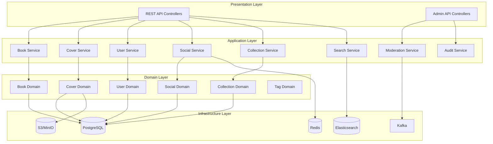

# Design Document: Book Cover Archive

## Overview

북커버 디자인 아카이브는 Spring Boot 기반의 백엔드 시스템으로, 원서와 번역서의 북커버를 수집, 비교, 공유할 수 있는 플랫폼입니다. 시스템은 확장성을 고려하여 향후 영화 포스터 등 다른 미디어 유형으로 확장 가능하도록 설계됩니다.

### 기술 스택

- **Backend**: Spring Boot 3.x (Kotlin)
- **Database**: PostgreSQL (관계형 데이터), Redis (캐싱, 레이트 리밋)
- **Search**: Elasticsearch (전문 검색)
- **Storage**: AWS S3 또는 MinIO (이미지 저장)
- **Message Queue**: Apache Kafka (비동기 처리)
- **Authentication**: Spring Security + JWT

## Architecture

시스템은 레이어드 아키텍처와 도메인 주도 설계(DDD)를 결합하여 구성됩니다.



## Components and Interfaces

### 1. 도메인 모델

#### 1.1 Media (추상 베이스)

확장성을 위한 미디어 추상 클래스:

```kotlin
@Entity
@Inheritance(strategy = InheritanceType.JOINED)
@DiscriminatorColumn(name = "media_type")
abstract class Media(
    @Id
    @GeneratedValue(strategy = GenerationType.UUID)
    val id: UUID = UUID.randomUUID(),

    @Column(nullable = false)
    var title: String,

    @Column(nullable = false)
    val countryCode: String,  // ISO 3166-1

    @Column(nullable = false)
    val languageCode: String,  // ISO 639-1

    @Column(nullable = false)
    val year: Int,

    @Enumerated(EnumType.STRING)
    var status: ContentStatus = ContentStatus.PUBLISHED,

    @ManyToOne(fetch = FetchType.LAZY)
    val createdBy: User,

    val createdAt: Instant = Instant.now(),
    var updatedAt: Instant = Instant.now()
)

enum class ContentStatus {
    DRAFT, PUBLISHED, HIDDEN, DELETED
}
```

#### 1.2 OriginalBook (원서)

```kotlin
@Entity
@DiscriminatorValue("BOOK_ORIGINAL")
class OriginalBook(
    title: String,
    countryCode: String,
    languageCode: String,
    year: Int,
    createdBy: User,

    @Column(nullable = false)
    val originalTitle: String,

    @Column(nullable = false)
    val genre: String,

    @Column(unique = true)
    val isbn: String? = null,

    @ManyToOne(fetch = FetchType.LAZY)
    val author: Author,

    @ManyToOne(fetch = FetchType.LAZY)
    val publisher: Publisher,

    @ManyToOne(fetch = FetchType.LAZY)
    val designer: Designer? = null,

    val edition: String? = null,

    @ManyToOne(fetch = FetchType.LAZY)
    val work: Work? = null,  // 같은 작품 그룹화

    @OneToMany(mappedBy = "originalBook", cascade = [CascadeType.ALL])
    val translations: MutableList<TranslatedBook> = mutableListOf(),

    @OneToOne(cascade = [CascadeType.ALL], optional = false)
    val frontCover: BookCover,

    @OneToOne(cascade = [CascadeType.ALL])
    val backCover: BookCover? = null
) : Media(title = title, countryCode = countryCode, languageCode = languageCode, year = year, createdBy = createdBy)
```

#### 1.3 TranslatedBook (번역서)

```kotlin
@Entity
@DiscriminatorValue("BOOK_TRANSLATED")
class TranslatedBook(
    title: String,
    countryCode: String,
    languageCode: String,
    year: Int,
    createdBy: User,

    @Column(unique = true)
    val isbn: String? = null,

    @ManyToOne(fetch = FetchType.LAZY, optional = false)
    val originalBook: OriginalBook,

    @ManyToOne(fetch = FetchType.LAZY)
    val author: Author,

    @ManyToOne(fetch = FetchType.LAZY)
    val translator: Translator,

    @ManyToOne(fetch = FetchType.LAZY)
    val publisher: Publisher,

    val edition: String? = null,

    @OneToOne(cascade = [CascadeType.ALL], optional = false)
    val frontCover: BookCover,

    @OneToOne(cascade = [CascadeType.ALL])
    val backCover: BookCover? = null
) : Media(title = title, countryCode = countryCode, languageCode = languageCode, year = year, createdBy = createdBy)
```

#### 1.4 BookCover (북커버)

```kotlin
@Entity
class BookCover(
    @Id
    @GeneratedValue(strategy = GenerationType.UUID)
    val id: UUID = UUID.randomUUID(),

    @Column(nullable = false)
    val imageUrl: String,

    @Column(nullable = false)
    val thumbnailUrl: String,

    @Column(nullable = false)
    val originalFileName: String,

    val width: Int,
    val height: Int,
    val fileSize: Long,

    @Enumerated(EnumType.STRING)
    val coverType: CoverType,

    @Enumerated(EnumType.STRING)
    val imageSource: ImageSource? = null,

    val sourceUrl: String? = null,

    @ManyToMany
    @JoinTable(name = "cover_tags")
    val tags: MutableSet<DesignTag> = mutableSetOf(),

    val dominantColor: String? = null,  // HEX color

    @Enumerated(EnumType.STRING)
    val layout: CoverLayout? = null,

    var likeCount: Int = 0,
    var commentCount: Int = 0,

    val createdAt: Instant = Instant.now()
)

enum class CoverType { FRONT, BACK }
enum class ImageSource { SCAN, PHOTO, LINK, OTHER }
enum class CoverLayout { CENTER, LEFT, RIGHT, FULL_BLEED, MINIMAL }
```

#### 1.5 Redesign (리디자인)

```kotlin
@Entity
class Redesign(
    @Id
    @GeneratedValue(strategy = GenerationType.UUID)
    val id: UUID = UUID.randomUUID(),

    @Column(nullable = false)
    val imageUrl: String,

    @Column(nullable = false)
    val thumbnailUrl: String,

    @Column(nullable = false, length = 2000)
    val description: String,

    @ManyToOne(fetch = FetchType.LAZY)
    val originalBook: OriginalBook? = null,

    @ManyToOne(fetch = FetchType.LAZY)
    val translatedBook: TranslatedBook? = null,

    @ManyToOne(fetch = FetchType.LAZY, optional = false)
    val createdBy: User,

    @ManyToMany
    @JoinTable(name = "redesign_tags")
    val tags: MutableSet<DesignTag> = mutableSetOf(),

    @Enumerated(EnumType.STRING)
    var status: ContentStatus = ContentStatus.PUBLISHED,

    var likeCount: Int = 0,
    var commentCount: Int = 0,

    val createdAt: Instant = Instant.now(),
    var updatedAt: Instant = Instant.now()
)
```

#### 1.6 User (회원)

```kotlin
@Entity
@Table(name = "users")
class User(
    @Id
    @GeneratedValue(strategy = GenerationType.UUID)
    val id: UUID = UUID.randomUUID(),

    @Column(nullable = false, unique = true)
    val email: String,

    @Column(nullable = false)
    var displayName: String,

    @Column(nullable = false)
    var passwordHash: String,

    @Enumerated(EnumType.STRING)
    @Column(nullable = false)
    var role: UserRole,

    @Enumerated(EnumType.STRING)
    var title: UserTitle = UserTitle.MEMBER,

    var websiteUrl: String? = null,
    var portfolioUrl: String? = null,

    @ElementCollection
    @CollectionTable(name = "user_sns_accounts")
    val snsAccounts: MutableMap<String, String> = mutableMapOf(),

    var contributionCount: Int = 0,

    @Enumerated(EnumType.STRING)
    var status: UserStatus = UserStatus.ACTIVE,

    var reportRestricted: Boolean = false,
    var suspendedUntil: Instant? = null,

    val createdAt: Instant = Instant.now(),
    var lastLoginAt: Instant? = null
)

enum class UserRole { PUBLISHER, AUTHOR, DESIGNER, MEMBER, ADMIN }
enum class UserTitle { MEMBER, CONTRIBUTOR }
enum class UserStatus { ACTIVE, SUSPENDED, DELETED }
```

#### 1.7 Collection (컬렉션)

```kotlin
@Entity
class Collection(
    @Id
    @GeneratedValue(strategy = GenerationType.UUID)
    val id: UUID = UUID.randomUUID(),

    @Column(nullable = false)
    var name: String,

    var description: String? = null,

    @Enumerated(EnumType.STRING)
    var visibility: CollectionVisibility = CollectionVisibility.PRIVATE,

    @Column(unique = true)
    val shareToken: String = UUID.randomUUID().toString(),

    @ManyToOne(fetch = FetchType.LAZY, optional = false)
    val owner: User,

    @OneToMany(mappedBy = "collection", cascade = [CascadeType.ALL], orphanRemoval = true)
    val items: MutableList<CollectionItem> = mutableListOf(),

    val createdAt: Instant = Instant.now(),
    var updatedAt: Instant = Instant.now()
)

enum class CollectionVisibility { PRIVATE, PUBLIC, LINK_ONLY }

@Entity
class CollectionItem(
    @Id
    @GeneratedValue(strategy = GenerationType.UUID)
    val id: UUID = UUID.randomUUID(),

    @ManyToOne(fetch = FetchType.LAZY, optional = false)
    val collection: Collection,

    @Enumerated(EnumType.STRING)
    val itemType: CollectionItemType,

    val itemId: UUID,

    val addedAt: Instant = Instant.now()
)

enum class CollectionItemType { ORIGINAL_COVER, TRANSLATED_COVER, REDESIGN }
```

#### 1.8 Social (좋아요, 댓글)

```kotlin
@Entity
@Table(uniqueConstraints = [UniqueConstraint(columnNames = ["user_id", "target_type", "target_id"])])
class Like(
    @Id
    @GeneratedValue(strategy = GenerationType.UUID)
    val id: UUID = UUID.randomUUID(),

    @ManyToOne(fetch = FetchType.LAZY, optional = false)
    val user: User,

    @Enumerated(EnumType.STRING)
    val targetType: LikeTargetType,

    val targetId: UUID,

    val createdAt: Instant = Instant.now()
)

enum class LikeTargetType { ORIGINAL_COVER, TRANSLATED_COVER, REDESIGN }

@Entity
class Comment(
    @Id
    @GeneratedValue(strategy = GenerationType.UUID)
    val id: UUID = UUID.randomUUID(),

    @Column(nullable = false, length = 1000)
    var content: String,

    @ManyToOne(fetch = FetchType.LAZY, optional = false)
    val author: User,

    @Enumerated(EnumType.STRING)
    val targetType: CommentTargetType,

    val targetId: UUID,

    @Enumerated(EnumType.STRING)
    var status: ContentStatus = ContentStatus.PUBLISHED,

    val createdAt: Instant = Instant.now(),
    var updatedAt: Instant = Instant.now()
)

enum class CommentTargetType { ORIGINAL_COVER, TRANSLATED_COVER, REDESIGN }
```

#### 1.9 DesignTag (디자인 태그)

```kotlin
@Entity
class DesignTag(
    @Id
    @GeneratedValue(strategy = GenerationType.UUID)
    val id: UUID = UUID.randomUUID(),

    @Column(nullable = false, unique = true)
    val name: String,

    @Enumerated(EnumType.STRING)
    val category: TagCategory,

    var usageCount: Int = 0,

    var approved: Boolean = true
)

enum class TagCategory { STYLE, COLOR, LAYOUT, TYPOGRAPHY, ILLUSTRATION }
```

#### 1.10 Report (신고)

```kotlin
@Entity
class Report(
    @Id
    @GeneratedValue(strategy = GenerationType.UUID)
    val id: UUID = UUID.randomUUID(),

    @ManyToOne(fetch = FetchType.LAZY, optional = false)
    val reporter: User,

    @Enumerated(EnumType.STRING)
    val targetType: ReportTargetType,

    val targetId: UUID,

    @Enumerated(EnumType.STRING)
    val reason: ReportReason,

    val description: String? = null,

    @Enumerated(EnumType.STRING)
    var status: ReportStatus = ReportStatus.PENDING,

    @ManyToOne(fetch = FetchType.LAZY)
    var reviewedBy: User? = null,

    var reviewNote: String? = null,
    var reviewedAt: Instant? = null,

    val createdAt: Instant = Instant.now()
)

enum class ReportTargetType { ORIGINAL_BOOK, TRANSLATED_BOOK, REDESIGN, COMMENT }
enum class ReportReason { INAPPROPRIATE, COPYRIGHT, SPAM, WRONG_INFO, OTHER }
enum class ReportStatus { PENDING, APPROVED, REJECTED }
```

#### 1.11 AuditLog (감사 로그)

```kotlin
@Entity
class AuditLog(
    @Id
    @GeneratedValue(strategy = GenerationType.UUID)
    val id: UUID = UUID.randomUUID(),

    @Enumerated(EnumType.STRING)
    val action: AuditAction,

    @Enumerated(EnumType.STRING)
    val entityType: AuditEntityType,

    val entityId: UUID,

    @ManyToOne(fetch = FetchType.LAZY, optional = false)
    val performedBy: User,

    @Column(columnDefinition = "jsonb")
    val previousValue: String? = null,

    @Column(columnDefinition = "jsonb")
    val newValue: String? = null,

    val createdAt: Instant = Instant.now()
)

enum class AuditAction { CREATE, UPDATE, DELETE, MERGE, SPLIT, STATUS_CHANGE }
enum class AuditEntityType { ORIGINAL_BOOK, TRANSLATED_BOOK, REDESIGN, USER, COLLECTION, AUTHOR, PUBLISHER, DESIGNER }
```


### 2. 서비스 인터페이스

#### 2.1 BookService

```kotlin
interface BookService {
    // 원서 관리
    fun createOriginalBook(request: CreateOriginalBookRequest): OriginalBook
    fun updateOriginalBook(id: UUID, request: UpdateOriginalBookRequest): OriginalBook
    fun getOriginalBook(id: UUID): OriginalBook?
    fun deleteOriginalBook(id: UUID)

    // 번역서 관리
    fun createTranslatedBook(originalBookId: UUID, request: CreateTranslatedBookRequest): TranslatedBook
    fun updateTranslatedBook(id: UUID, request: UpdateTranslatedBookRequest): TranslatedBook
    fun getTranslatedBook(id: UUID): TranslatedBook?
    fun deleteTranslatedBook(id: UUID)

    // 조회
    fun getTranslationsByOriginalBook(originalBookId: UUID): List<TranslatedBook>
    fun getBooksByAuthor(authorId: UUID, pageable: Pageable): Page<Media>
    fun getBooksByPublisher(publisherId: UUID, pageable: Pageable): Page<Media>
    fun getBooksByDesigner(designerId: UUID, pageable: Pageable): Page<Media>

    // 중복 검사
    fun findDuplicatesByIsbn(isbn: String): List<Media>
    fun findSimilarBooks(title: String, authorName: String, year: Int): List<Media>
}
```

#### 2.2 RedesignService

```kotlin
interface RedesignService {
    fun createRedesign(request: CreateRedesignRequest): Redesign
    fun updateRedesign(id: UUID, request: UpdateRedesignRequest): Redesign
    fun getRedesign(id: UUID): Redesign?
    fun deleteRedesign(id: UUID)

    fun getRedesignsByOriginalBook(originalBookId: UUID, pageable: Pageable): Page<Redesign>
    fun getRedesignsByTranslatedBook(translatedBookId: UUID, pageable: Pageable): Page<Redesign>
    fun getRedesignsByUser(userId: UUID, pageable: Pageable): Page<Redesign>
}
```

#### 2.3 SocialService

```kotlin
interface SocialService {
    // 좋아요
    fun toggleLike(userId: UUID, targetType: LikeTargetType, targetId: UUID): Boolean
    fun getLikeCount(targetType: LikeTargetType, targetId: UUID): Int
    fun isLikedByUser(userId: UUID, targetType: LikeTargetType, targetId: UUID): Boolean

    // 댓글
    fun createComment(request: CreateCommentRequest): Comment
    fun updateComment(id: UUID, content: String): Comment
    fun deleteComment(id: UUID)
    fun getComments(targetType: CommentTargetType, targetId: UUID, pageable: Pageable): Page<Comment>
}
```

#### 2.4 CollectionService

```kotlin
interface CollectionService {
    fun createCollection(request: CreateCollectionRequest): Collection
    fun updateCollection(id: UUID, request: UpdateCollectionRequest): Collection
    fun deleteCollection(id: UUID)
    fun getCollection(id: UUID): Collection?
    fun getCollectionByShareToken(token: String): Collection?

    fun addItem(collectionId: UUID, itemType: CollectionItemType, itemId: UUID)
    fun removeItem(collectionId: UUID, itemId: UUID)

    fun getUserCollections(userId: UUID, pageable: Pageable): Page<Collection>
    fun getPublicCollections(pageable: Pageable): Page<Collection>
    fun duplicateCollection(collectionId: UUID, newOwnerId: UUID): Collection
}
```

#### 2.5 SearchService

```kotlin
interface SearchService {
    fun search(query: String, filters: SearchFilters, pageable: Pageable): SearchResult
    fun browseByCountry(countryCode: String, pageable: Pageable): Page<Media>
    fun browseByYear(year: Int, pageable: Pageable): Page<Media>
    fun browseByGenre(genre: String, pageable: Pageable): Page<Media>
    fun browseByTag(tagId: UUID, pageable: Pageable): Page<BookCover>

    fun reindexAll()
    fun indexBook(bookId: UUID)
    fun removeFromIndex(bookId: UUID)
}

data class SearchFilters(
    val countryCode: String? = null,
    val languageCode: String? = null,
    val yearFrom: Int? = null,
    val yearTo: Int? = null,
    val genre: String? = null,
    val publisherId: UUID? = null,
    val tags: List<UUID>? = null,
    val sortBy: SortOption = SortOption.RELEVANCE
)

enum class SortOption { RELEVANCE, LIKES, NEWEST, YEAR_ASC, YEAR_DESC }
```

#### 2.6 ModerationService

```kotlin
interface ModerationService {
    // 신고 관리
    fun createReport(request: CreateReportRequest): Report
    fun getReportQueue(pageable: Pageable): Page<Report>
    fun reviewReport(reportId: UUID, decision: ReportDecision, note: String?)

    // 콘텐츠 관리
    fun hideContent(targetType: ReportTargetType, targetId: UUID, reason: String)
    fun restoreContent(targetType: ReportTargetType, targetId: UUID)
    fun deleteContent(targetType: ReportTargetType, targetId: UUID, reason: String)

    // 사용자 관리
    fun suspendUser(userId: UUID, duration: Duration, reason: String)
    fun restrictReporting(userId: UUID)

    // 중복 관리
    fun getDuplicateSuggestions(pageable: Pageable): Page<DuplicateSuggestion>
    fun mergeEntities(sourceId: UUID, targetId: UUID, entityType: AuditEntityType)
}

data class ReportDecision(
    val status: ReportStatus,
    val action: ModerationAction?
)

enum class ModerationAction { HIDE, DELETE, WARN_USER, SUSPEND_USER }
```

#### 2.7 ImageService

```kotlin
interface ImageService {
    fun uploadImage(file: MultipartFile, type: ImageType): ImageUploadResult
    fun validateImage(file: MultipartFile): ImageValidationResult
    fun generateThumbnail(imageUrl: String): String
    fun extractDominantColor(imageUrl: String): String
    fun deleteImage(imageUrl: String)
}

data class ImageUploadResult(
    val originalUrl: String,
    val thumbnailUrl: String,
    val width: Int,
    val height: Int,
    val fileSize: Long
)

data class ImageValidationResult(
    val valid: Boolean,
    val errors: List<String>
)

enum class ImageType { COVER, REDESIGN, PROFILE }
```

#### 2.8 RateLimitService

```kotlin
interface RateLimitService {
    fun checkLimit(userId: UUID, action: RateLimitAction): RateLimitResult
    fun recordAction(userId: UUID, action: RateLimitAction)
    fun isUserRestricted(userId: UUID): Boolean
}

enum class RateLimitAction {
    UPLOAD, COMMENT, LIKE, REPORT
}

data class RateLimitResult(
    val allowed: Boolean,
    val remainingAttempts: Int,
    val resetTime: Instant?
)
```

## Data Models

### API Request/Response DTOs

```kotlin
// 원서 등록 요청
data class CreateOriginalBookRequest(
    val title: String,
    val originalTitle: String,
    val countryCode: String,
    val languageCode: String,
    val year: Int,
    val genre: String,
    val isbn: String?,
    val authorId: UUID?,
    val authorName: String?,
    val publisherId: UUID?,
    val publisherName: String?,
    val designerId: UUID?,
    val designerName: String?,
    val edition: String?,
    val frontCover: MultipartFile,
    val backCover: MultipartFile?,
    val imageSource: ImageSource?,
    val sourceUrl: String?
)

// 검색 결과
data class SearchResult(
    val items: List<SearchResultItem>,
    val totalCount: Long,
    val facets: SearchFacets
)

data class SearchResultItem(
    val id: UUID,
    val type: MediaType,
    val title: String,
    val thumbnailUrl: String,
    val author: String,
    val publisher: String,
    val year: Int,
    val countryCode: String,
    val likeCount: Int
)

data class SearchFacets(
    val countries: Map<String, Long>,
    val years: Map<Int, Long>,
    val genres: Map<String, Long>,
    val tags: Map<String, Long>
)
```

### Elasticsearch 인덱스 매핑

```json
{
  "book_covers": {
    "mappings": {
      "properties": {
        "id": { "type": "keyword" },
        "type": { "type": "keyword" },
        "title": {
          "type": "text",
          "analyzer": "korean_analyzer",
          "fields": {
            "keyword": { "type": "keyword" }
          }
        },
        "originalTitle": { "type": "text", "analyzer": "standard" },
        "author": { "type": "text", "analyzer": "korean_analyzer" },
        "publisher": { "type": "text", "analyzer": "korean_analyzer" },
        "designer": { "type": "text", "analyzer": "korean_analyzer" },
        "isbn": { "type": "keyword" },
        "countryCode": { "type": "keyword" },
        "languageCode": { "type": "keyword" },
        "year": { "type": "integer" },
        "genre": { "type": "keyword" },
        "tags": { "type": "keyword" },
        "likeCount": { "type": "integer" },
        "createdAt": { "type": "date" }
      }
    }
  }
}
```


## Correctness Properties

*A property is a characteristic or behavior that should hold true across all valid executions of a system—essentially, a formal statement about what the system should do. Properties serve as the bridge between human-readable specifications and machine-verifiable correctness guarantees.*

### Property 1: 원서 등록 입력 검증

*For any* 원서 등록 요청에서, 필수 항목(책 제목, 원서 제목, 나라, 언어, 연도, 작가, 출판사, 장르, 앞면 북커버) 중 하나라도 누락되면 등록이 거부되어야 하고, 모든 필수 항목이 제공되면 등록이 성공해야 한다.

**Validates: Requirements 1.1, 1.3**

### Property 2: ISBN 형식 검증

*For any* ISBN 문자열에 대해, 유효한 ISBN-10 또는 ISBN-13 형식이면 검증을 통과하고, 그렇지 않으면 검증이 실패해야 한다.

**Validates: Requirements 1.2, 2.3**

### Property 3: 원서 등록 라운드트립

*For any* 유효한 원서 등록 요청에 대해, 등록 후 생성된 ID로 조회하면 동일한 데이터가 반환되어야 한다.

**Validates: Requirements 1.5**

### Property 4: 번역서-원서 연결

*For any* 번역서 등록에 대해, 등록 후 해당 번역서는 지정된 원서와 연결되어야 하고, 원서의 번역서 목록에 포함되어야 한다.

**Validates: Requirements 2.1, 2.6**

### Property 5: 좋아요 토글

*For any* 회원과 북커버에 대해, 좋아요를 두 번 누르면 좋아요 상태가 원래대로 돌아가고 좋아요 수도 원래 값으로 복원되어야 한다.

**Validates: Requirements 4.1, 4.2**

### Property 6: 공백 댓글 거부

*For any* 공백 문자(스페이스, 탭, 줄바꿈 등)로만 구성된 문자열에 대해, 댓글 등록이 거부되어야 한다.

**Validates: Requirements 5.2**

### Property 7: 댓글 삭제

*For any* 등록된 댓글에 대해, 작성자가 삭제하면 해당 댓글이 더 이상 조회되지 않아야 한다.

**Validates: Requirements 5.4**

### Property 8: 에디션 그룹화

*For any* 같은 작품(Work)에 속하는 여러 에디션에 대해, 각 에디션은 독립적인 엔트리로 존재하면서 동일한 작품 그룹에 속해야 한다.

**Validates: Requirements 6.1**

### Property 9: 컨트리뷰터 칭호 자동 부여

*For any* 일반 회원에 대해, 등록한 책의 수가 10권 이상이 되면 칭호가 "컨트리뷰터"로 변경되어야 한다.

**Validates: Requirements 7.5**

### Property 10: 검색 결과 관련성

*For any* 검색어에 대해, 반환된 모든 결과는 제목, 작가, 출판사, 디자이너 이름, 또는 ISBN 중 하나 이상에서 검색어와 일치해야 한다.

**Validates: Requirements 8.1**

### Property 11: 컬렉션 아이템 관리

*For any* 컬렉션과 북커버에 대해, 아이템을 추가하면 컬렉션에 포함되고, 제거하면 컬렉션에서 제외되어야 한다.

**Validates: Requirements 11.2, 11.7**

### Property 12: ISBN 중복 감지

*For any* 이미 등록된 ISBN과 동일한 ISBN으로 새 책을 등록하려 하면, 시스템은 중복을 감지하고 기존 엔트리 정보를 반환해야 한다.

**Validates: Requirements 12.1**

### Property 13: 데이터 정규화

*For any* 나라, 언어, 연도 입력에 대해, 저장된 값은 각각 ISO 3166-1 국가 코드, ISO 639-1 언어 코드, 4자리 연도 형식을 따라야 한다.

**Validates: Requirements 13.1, 13.2, 13.3**

### Property 14: 이미지 검증

*For any* 업로드된 이미지에 대해, 해상도가 800x1200 미만이거나, 파일 형식이 JPEG/PNG/WebP가 아니거나, 파일 크기가 10MB를 초과하면 업로드가 거부되어야 한다.

**Validates: Requirements 14.1, 14.4, 14.5**

### Property 15: 자동 비공개 처리

*For any* 콘텐츠에 대해, 3회 이상 신고가 접수되면 해당 콘텐츠의 상태가 자동으로 HIDDEN으로 변경되어야 한다.

**Validates: Requirements 15.4**

### Property 16: 감사 로그 기록

*For any* 엔티티 수정에 대해, 수정 전 값, 수정 후 값, 수정자, 수정 시간이 감사 로그에 기록되어야 한다.

**Validates: Requirements 16.1**

### Property 17: 레이트 리밋 적용

*For any* 사용자와 액션(댓글, 좋아요, 신고, 업로드)에 대해, 설정된 시간 내에 허용된 횟수를 초과하면 추가 요청이 거부되어야 한다.

**Validates: Requirements 18.1**

## Error Handling

### 에러 응답 형식

```kotlin
data class ErrorResponse(
    val code: String,
    val message: String,
    val details: Map<String, Any>? = null,
    val timestamp: Instant = Instant.now()
)
```

### 에러 코드 체계

| 코드 | 설명 | HTTP 상태 |
|------|------|-----------|
| `VALIDATION_ERROR` | 입력 검증 실패 | 400 |
| `INVALID_ISBN` | 잘못된 ISBN 형식 | 400 |
| `INVALID_IMAGE` | 이미지 검증 실패 | 400 |
| `DUPLICATE_ISBN` | ISBN 중복 | 409 |
| `NOT_FOUND` | 리소스 없음 | 404 |
| `UNAUTHORIZED` | 인증 필요 | 401 |
| `FORBIDDEN` | 권한 없음 | 403 |
| `RATE_LIMITED` | 요청 제한 초과 | 429 |
| `CONTENT_HIDDEN` | 비공개 콘텐츠 | 403 |
| `USER_SUSPENDED` | 정지된 계정 | 403 |
| `INTERNAL_ERROR` | 서버 오류 | 500 |

### 예외 처리 전략

```kotlin
@RestControllerAdvice
class GlobalExceptionHandler {

    @ExceptionHandler(ValidationException::class)
    fun handleValidation(ex: ValidationException): ResponseEntity<ErrorResponse> {
        return ResponseEntity.badRequest().body(
            ErrorResponse(
                code = "VALIDATION_ERROR",
                message = ex.message ?: "Validation failed",
                details = ex.errors
            )
        )
    }

    @ExceptionHandler(DuplicateIsbnException::class)
    fun handleDuplicateIsbn(ex: DuplicateIsbnException): ResponseEntity<ErrorResponse> {
        return ResponseEntity.status(HttpStatus.CONFLICT).body(
            ErrorResponse(
                code = "DUPLICATE_ISBN",
                message = "ISBN already exists",
                details = mapOf("existingBookId" to ex.existingBookId)
            )
        )
    }

    @ExceptionHandler(RateLimitExceededException::class)
    fun handleRateLimit(ex: RateLimitExceededException): ResponseEntity<ErrorResponse> {
        return ResponseEntity.status(HttpStatus.TOO_MANY_REQUESTS)
            .header("Retry-After", ex.retryAfterSeconds.toString())
            .body(
                ErrorResponse(
                    code = "RATE_LIMITED",
                    message = "Too many requests",
                    details = mapOf(
                        "retryAfter" to ex.retryAfterSeconds,
                        "limit" to ex.limit
                    )
                )
            )
    }
}
```

## Testing Strategy

### 테스트 유형

1. **단위 테스트 (Unit Tests)**
   - 개별 서비스 로직 검증
   - 도메인 모델 검증
   - 유틸리티 함수 검증

2. **속성 기반 테스트 (Property-Based Tests)**
   - 모든 Correctness Properties 검증
   - 최소 100회 반복 실행
   - Kotest Property Testing 라이브러리 사용

3. **통합 테스트 (Integration Tests)**
   - API 엔드포인트 검증
   - 데이터베이스 연동 검증
   - 외부 서비스 연동 검증

### 속성 기반 테스트 설정

```kotlin
// build.gradle.kts
dependencies {
    testImplementation("io.kotest:kotest-runner-junit5:5.8.0")
    testImplementation("io.kotest:kotest-property:5.8.0")
    testImplementation("io.kotest:kotest-assertions-core:5.8.0")
}
```

### 테스트 예시

```kotlin
class BookServicePropertyTest : FunSpec({

    // Feature: book-cover-archive, Property 1: 원서 등록 입력 검증
    test("원서 등록 시 필수 항목 검증") {
        checkAll(100, Arb.createOriginalBookRequest()) { request ->
            val missingFields = findMissingRequiredFields(request)

            if (missingFields.isEmpty()) {
                // 모든 필수 항목이 있으면 성공
                val result = bookService.createOriginalBook(request)
                result.shouldNotBeNull()
            } else {
                // 필수 항목이 누락되면 실패
                shouldThrow<ValidationException> {
                    bookService.createOriginalBook(request)
                }
            }
        }
    }

    // Feature: book-cover-archive, Property 2: ISBN 형식 검증
    test("ISBN 형식 검증") {
        checkAll(100, Arb.string(10..13)) { isbn ->
            val isValid = isValidIsbn(isbn)
            val result = isbnValidator.validate(isbn)

            result.isValid shouldBe isValid
        }
    }

    // Feature: book-cover-archive, Property 5: 좋아요 토글
    test("좋아요 두 번 누르면 원래 상태로 복원") {
        checkAll(100, Arb.uuid(), Arb.uuid()) { userId, coverId ->
            val initialCount = socialService.getLikeCount(LikeTargetType.ORIGINAL_COVER, coverId)
            val initialLiked = socialService.isLikedByUser(userId, LikeTargetType.ORIGINAL_COVER, coverId)

            // 첫 번째 토글
            socialService.toggleLike(userId, LikeTargetType.ORIGINAL_COVER, coverId)
            // 두 번째 토글
            socialService.toggleLike(userId, LikeTargetType.ORIGINAL_COVER, coverId)

            val finalCount = socialService.getLikeCount(LikeTargetType.ORIGINAL_COVER, coverId)
            val finalLiked = socialService.isLikedByUser(userId, LikeTargetType.ORIGINAL_COVER, coverId)

            finalCount shouldBe initialCount
            finalLiked shouldBe initialLiked
        }
    }

    // Feature: book-cover-archive, Property 6: 공백 댓글 거부
    test("공백만 있는 댓글은 거부") {
        checkAll(100, Arb.whitespaceString()) { whitespaceContent ->
            shouldThrow<ValidationException> {
                socialService.createComment(
                    CreateCommentRequest(
                        content = whitespaceContent,
                        targetType = CommentTargetType.ORIGINAL_COVER,
                        targetId = UUID.randomUUID()
                    )
                )
            }
        }
    }
})

// 커스텀 Arbitrary 생성기
fun Arb.Companion.whitespaceString(): Arb<String> = arbitrary {
    val whitespaceChars = listOf(' ', '\t', '\n', '\r')
    val length = Arb.int(0..100).bind()
    (0 until length).map { whitespaceChars.random() }.joinToString("")
}
```

### 테스트 커버리지 목표

- 단위 테스트: 80% 이상 라인 커버리지
- 속성 기반 테스트: 모든 Correctness Properties 커버
- 통합 테스트: 모든 API 엔드포인트 커버
