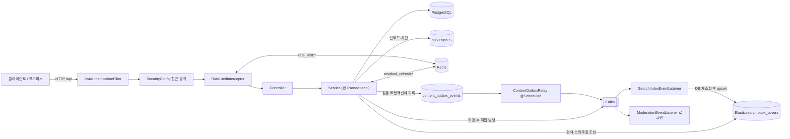
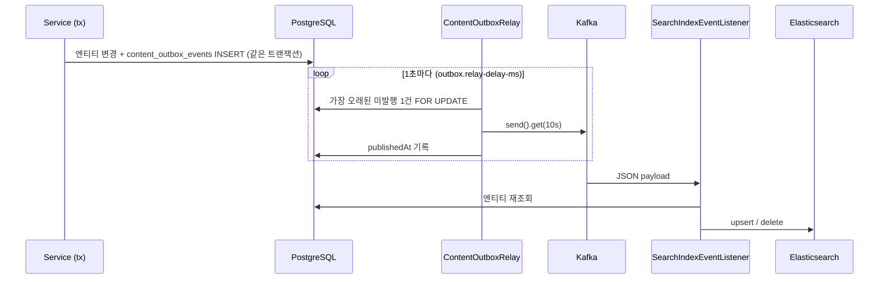

# 아키텍처

백엔드의 구성과 요청·이벤트 흐름, 설계 의도. 실행 방법은 [README.md](README.md), 규칙은 [CLAUDE.md](CLAUDE.md), 엔티티 상세는 [docs/DATA_MODEL.md](docs/DATA_MODEL.md), 엔드포인트는 [docs/API.md](docs/API.md), 알려진 결함은 [docs/KNOWN_ISSUES.md](docs/KNOWN_ISSUES.md).

## 시스템 개요



단일 Spring Boot 모듈(`com.bookcover.archive`). **PostgreSQL이 진실의 원천**이고 Elasticsearch는 검색·브라우징용 읽기 모델로 Kafka를 거쳐 비동기로 갱신된다.

| 구성 요소 | 역할 | 코드 |
|---|---|---|
| PostgreSQL | 모든 엔티티, 콘텐츠 이벤트 outbox | `domain/`, `repository/`, `event/ContentOutboxEvent` |
| Redis | 레이트 리밋 카운터·환불 카운터, 폐기된 리프레시 토큰 jti | `RateLimitServiceImpl`, `AuthServiceImpl` |
| Elasticsearch (`book_covers`, nori) | 전문 검색, 나라·연도·장르·태그 브라우징, 최신 갤러리 | `search/`, `SearchServiceImpl`, `BrowsingServiceImpl` |
| Kafka | 콘텐츠 이벤트(검색 색인), 모더레이션 이벤트 | `event/`, `config/KafkaConfig` |
| S3 / RustFS | 표지·리디자인 원본과 썸네일 | `ImageServiceImpl`, `config/S3Config` |

## 패키지 구조

```
config/            Elasticsearch·JPA·Kafka·OpenAPI·S3·WebMvc 설정, OutboxSchedulingConfig
config/security/   JWT 필터·토큰·SecurityConfig·SecurityUtils·CustomUserDetails
config/ratelimit/  @RateLimited, RateLimitInterceptor
controller/        공개·회원 API (+ AdminTagController는 여기 있지만 /admin 경로)
controller/admin/  관리자 API (클래스마다 @PreAuthorize ADMIN)
controller/dto/    응답 DTO (요청 DTO는 컨트롤러 내부 record 또는 service/dto/)
service/           인터페이스, service/dto/ 요청·결과 DTO
service/impl/      *ServiceImpl + 이미지 유틸(ColorExtractor, ColorSpaceConverter, ImageFingerprint)
repository/        Spring Data JPA (+ BookSearchRepositoryImpl 커스텀 쿼리)
domain/<영역>/     엔티티·enum
search/            ES 문서·리포지토리
event/             이벤트 DTO, KafkaEventPublisher, outbox, listener/
validation/        ImageValidator, ISBN·국가·언어·URL 제약
exception/         ErrorCode, GlobalExceptionHandler, 도메인 예외
```

## 요청 처리 흐름

1. **`JwtAuthenticationFilter`**: `Authorization: Bearer`에서 `typ=access` 토큰만 받아 이메일을 꺼내고 **매 요청 DB에서 사용자를 다시 읽는다**. 토큰의 `uid`가 그 사용자 ID와 같고(`JwtTokenProvider.isIssuedTo`) `isEnabled() && isAccountNonLocked()`일 때만 `CustomUserDetails` principal을 설정한다. 정지 기간이 지난 SUSPENDED 계정은 DB가 아직 SUSPENDED여도 잠금 해제로 본다(`CustomUserDetails.isAccountNonLocked`). 잘못된 토큰은 로그만 남기고 비로그인으로 계속 진행한다. 역할·상태 변경은 토큰 재발급 없이 다음 요청부터 반영된다.
2. **`SecurityConfig`**: 공개 GET, `/auth/**`, 비회원 `POST /takedowns`, `/admin/**`=ADMIN, 나머지 인증. Stateless, CSRF off, `@EnableMethodSecurity`.
3. **`RateLimitInterceptor`**: `@RateLimited`가 붙은 핸들러만 처리([레이트 리밋](#레이트-리밋)).
4. **Controller**: `@Valid`로 요청 검증 후 서비스 호출. 엔티티→DTO 변환을 **서비스 트랜잭션이 끝난 뒤** 하므로 `spring.jpa.open-in-view: true`가 필요하다.
5. **Service**: 인터페이스 + `impl/`, 대부분 클래스 레벨 `@Transactional`. 예외: `ImageServiceImpl`(업로드는 트랜잭션 없음), `AuthServiceImpl`·`ImageInspectionServiceImpl`(메서드 레벨, `scan`은 `NOT_SUPPORTED`).
6. **에러**: 도메인 예외 → `GlobalExceptionHandler` → `ErrorResponse`. 상태 매핑은 [docs/API.md](docs/API.md#응답-형식).

### 인증 토큰

- 액세스 토큰(24h)·리프레시 토큰(7d) 모두 `typ`·`uid` 클레임을 가진다. 서로 대신 쓸 수 없다.
- 리프레시 토큰은 1회용: 갱신·로그아웃 시 jti를 Redis `revoked_refresh:{jti}`에 `setIfAbsent`(TTL=남은 유효기간). 액세스 토큰은 폐기 수단이 없다.
- 로그인 시 정지 기간이 지났으면 ACTIVE로 복구한다(`AuthServiceImpl`).

### 관리자 권한 검사 위치

- URL 규칙 `/admin/**` + `controller/admin/*`의 `@PreAuthorize`가 1차.
- 서비스 재검증: `TakedownServiceImpl`(approve/reject), `ModerationServiceImpl.reviewReport`는 DB 역할 확인. `CatalogServiceImpl`, `RelationshipServiceImpl`, `ImageInspectionServiceImpl`, `CoverGroupServiceImpl`, `TagServiceImpl`은 `SecurityUtils.hasRole("ADMIN")` → 실패 시 `ValidationException`(400). `ModerationServiceImpl`의 hide/restore/delete/suspend/restrict는 URL 규칙에만 의존한다.
- DRAFT 원서 생성은 `BookServiceImpl`에서 ADMIN만 허용.

## 도메인 요약

상세 필드·제약은 [docs/DATA_MODEL.md](docs/DATA_MODEL.md).

- **Media(JOINED) = OriginalBook | TranslatedBook.** 번역서는 원서 하나에 반드시 속한다. `Work`는 같은 작품의 여러 원서 판을 묶는다(원서만 `work_id`를 가짐).
- **표지(BookCover)**: 책마다 대표 앞면(`front_cover_id`, 필수), 선택 뒷면(`back_cover_id`), 같은 ISBN의 앞면 변형(`book_id`가 같은 다른 표지: 리커버·특정 쇄·특별판). **크레딧은 책이 아니라 표지에 붙는다.** 디자이너 프로필, `/designers/{id}/covers`, ES `designers`는 모두 표지 크레딧에서 나온다.
- **위키식 편집**: 로그인 사용자는 누구나 어떤 책이든 수정·표지 추가·대표 표지 변경을 할 수 있다(의도된 결정, 소유권 검사 없음). 바뀐 필드만 이전 값과 함께 `UPDATE` 감사 로그로 남고 `GET /admin/dashboard/logs/entity/{ORIGINAL_BOOK|TRANSLATED_BOOK}/{id}`로 본다. 되돌리기는 수동(이전 값으로 PUT). **책 삭제와 리디자인 수정·삭제는 위키 모델이 아니다** — 등록자(작성자) 또는 ADMIN만 허용한다(서비스의 `requireCreatorOrAdmin`, DB 역할 기준, 실패 시 `AccessDeniedException` → 403).
- **공개 상태**: `ContentStatus` = DRAFT/PUBLISHED/HIDDEN/DELETED. 공개 경로는 PUBLISHED만. 표지는 별도 `hidden` 플래그.
- **기여자**: Author/Publisher/Designer/Translator는 별칭을 가진 별도 엔티티. 이름 unique가 없어 중복은 관리자 병합으로 정리.
- **다형 대상**: Like/Comment/CollectionItem/Report는 FK 없이 `(targetType, targetId)`. 서비스가 존재를 확인한다.
- **비정규화 카운터**(좋아요·댓글·기여 수)는 `@Modifying @Query` 단일 UPDATE로만 바꾼다.
- **칭호**: MEMBER의 `contributionCount`가 10 이상이면 CONTRIBUTOR(`ContributionServiceImpl`: 증가 UPDATE 후 조건부 칭호 UPDATE).

## 비동기 흐름 (Kafka)

| 토픽 | 발행 | 소비 | 결과 |
|---|---|---|---|
| `bookcover.content.events` | **outbox 경유.** Book/Redesign 생성·수정·삭제, Moderation hide/restore/delete(댓글 제외), Takedown 승인, 좋아요 토글, 태그 변경, Catalog 표지 수정, 관계 수정, 회원 탈퇴(리디자인 재색인), 디자이너 병합 | `SearchIndexEventListener` (group `search-index-sync`) | DB에서 다시 읽어 ES 문서 upsert/삭제. 엔티티가 없으면 건너뜀 |
| `bookcover.moderation.events` | `ModerationServiceImpl`: `CONTENT_REPORTED`, `CONTENT_AUTO_HIDDEN`만 실제 발행 | `ModerationEventListener` (group `moderation-notification`) | **로그만.** 알림은 TODO |
| `bookcover.search.index` | `publishSearchIndexEvent`가 있으나 호출처 없음 | 없음 | 미사용 |

### 콘텐츠 이벤트 outbox



- `KafkaEventPublisher.publishContentEvent`는 호출한 서비스의 트랜잭션 안에서 outbox 행을 저장한다. 커밋되면 이벤트는 유실되지 않는다(at-least-once, 리스너는 DB 재조회라 중복에 안전).
- 모더레이션 이벤트는 아직 `afterCommit` 직접 발행이라 커밋과 발행 사이에 앱이 죽으면 유실된다.
- 리스너 예외는 전파된다 → `KafkaConfig.kafkaErrorHandler`가 1초 간격 3회 재시도 후 `bookcover.content.events.DLT`. JSON 파싱 오류는 재시도하지 않는다. DLT는 자동 재처리되지 않으며 복구는 `POST /admin/search/reindex`.
- 한계(릴레이 처리량, 실패 이벤트가 큐 앞을 막는 문제)는 [docs/KNOWN_ISSUES.md](docs/KNOWN_ISSUES.md).

## 검색

- 인덱스에는 모든 상태의 문서가 들어가고, 쿼리에서 `status=PUBLISHED`로 거른다. 상태 변경은 재색인 이벤트만으로 반영된다.
- `SearchController`: `/search`(필터·정렬), `/search/browse/{latest|country|year|genre|tag}`. `BrowsingServiceImpl`은 `TagController`(`/tags/popular`, `/tags/{id}/covers`)만 쓴다.
- `POST /admin/search/reindex`: `deleteAll()` 후 원서·번역서·리디자인 전체를 동기로 다시 저장(도중 검색이 비어 보임).
- 인덱스 설정은 `src/main/resources/elasticsearch/book-covers-settings.json`(nori 필수). 인덱스가 없을 때만 매핑과 함께 생성된다.

## 레이트 리밋

- Redis 고정 윈도우, 키 `rate_limit:{action}:{subject}`(action 소문자). INCR+EXPIRE를 Lua 스크립트 하나로 원자 실행 → 동시 요청이 한도를 넘거나 TTL 없는 키가 생기지 않는다.
- subject: 로그인 `user:{uuid}`, 비로그인 `ip:{remoteAddr}`. prod는 `server.forward-headers-strategy: native`.
- 4xx로 끝나면 `afterCompletion`에서 1회 환불, 윈도우당 한도×3회까지(`rate_limit:fail:*`로 셈). 5xx·예외는 환불 없음.
- `rate-limit.exempt-user-ids`(`RATE_LIMIT_EXEMPT_USER_IDS`)의 사용자는 건너뛴다.
- 초과 시 `RateLimitExceededException` → 429 + `Retry-After`. 액션별 대상 엔드포인트는 [docs/API.md](docs/API.md#레이트-리밋).

## 모더레이션과 테이크다운

- **신고**: `POST /reports`. 대상 행을 `SELECT … FOR UPDATE`(`findByIdForUpdate`)로 잠근 뒤 중복 검사·건수 집계를 하므로 동시 신고가 직렬화된다. 대상별 신고가 정확히 **3건**(`AUTO_HIDE_THRESHOLD`)이 되면 HIDDEN + `CONTENT_AUTO_HIDDEN`. 신고 제한 사용자·정지 중인 사용자는 거절.
- 관리자는 `/admin/reports/queue`에서 검토하고 `/admin/moderation`으로 숨김·복구·삭제·정지.
- **테이크다운**: 권리자(비회원 가능)가 `POST /takedowns`. 관리자 승인 시 대상 콘텐츠를 HIDDEN으로 바꾸고 이미지를 차단·S3에서 삭제한다. 세부 규칙은 [docs/API.md](docs/API.md#테이크다운-승인의-효과).

## 이미지 파이프라인

`CoverController` → `ImageService.uploadImage` (트랜잭션 없음):

1. `ImageValidator`(컨트롤러와 서비스에서 두 번): 형식(content-type **또는** 확장자가 jpeg/png/webp), 10MB, 헤더 기준 4천만 픽셀(`MAX_PIXELS`, 디코딩 전), 최소 800×1200(`image.resolution-exempt-user-ids` 면제). **한도는 `ImageValidator` 상수**이며 `application.yml`의 `image.min-width/min-height/max-file-size/allowed-formats`는 읽히지 않는다.
2. 디코딩 → sRGB 변환 → 픽셀 SHA-256(`sha256`). 차단된 해시면 거절.
3. 원본 재인코딩(알파 있는 JPEG는 흰 배경 합성, 0바이트 인코딩은 예외) → `ImageFingerprint`로 파일 SHA-256 + dHash.
4. 썸네일: 너비 300 기준 비율 유지(`Scalr.Mode.FIT_TO_WIDTH`, `image.thumbnail.height`는 사실상 무시).
5. S3 PUT 원본 `{type}/{uuid}.{ext}` → 썸네일 `{type}/thumbnails/{uuid}_thumb.{ext}`.
6. `image_assets` 행 저장. 이후 책·리디자인 저장은 이 기록이 있는 URL만 받는다(`requireVerifiedImage`).

Spring multipart 한도: 파일 10MB, 요청 15MB.

## 관리자 백오피스 기능

백오피스 웹앱(`../coverage-backoffice`)이 쓰는 API. 계약은 [docs/API.md](docs/API.md#관리자-api-admin--admin).

- **카탈로그** (`CatalogServiceImpl`): 원서·번역서를 모든 상태로 조회하는 네이티브 SQL 목록 + 보완 항목(issue) 계산, 표지 메타데이터·크레딧 수정(감사 로그 + 이벤트). SQL은 PostgreSQL과 H2(PostgreSQL 모드) 양쪽에서 돌아야 한다(테스트가 H2).
- **관계 수정** (`RelationshipServiceImpl.apply`): 대상 도서 ID들을 `TreeSet`에 모아 **항상 같은 순서로** `PESSIMISTIC_WRITE` 잠금(교착 방지) → `em.refresh`로 1차 캐시 갱신 → 미리보기 때의 `expected*` 값과 다시 비교해 다르면 거절. 하위 번역서는 갱신하지 않고 검색 이벤트만 발행.
- **표지 묶기** (`CoverGroupServiceImpl`): `similarGroupId` UUID만 바꾼다. 한 개만 남은 묶음은 해제. 잠금·감사·이벤트 없음.
- **이미지 검사** (`ImageInspectionServiceImpl`): 커서 기반으로 구형 표지의 해시를 채우고(파일별 트랜잭션), 매칭은 요청마다 전체 표지 쌍을 비교한다(O(n²)).

## 감사 로그

`AuditService.log`(수행자 필수)를 호출하는 곳:
- `BookServiceImpl`: 책 수정(바뀐 필드만), 표지 추가, 대표 표지 변경. `editorId`가 있을 때만.
- `CatalogServiceImpl.updateCover`, `RelationshipServiceImpl.apply`, `EntityManagementServiceImpl` 병합.

생성·삭제·모더레이션·테이크다운·태그·표지 묶기·정지는 기록하지 않는다.

## 주요 설계 결정

| 결정 | 이유 / 트레이드오프 |
|---|---|
| 위키식 책 편집(소유권 검사 없음, 삭제·리디자인 제외) | 아카이브를 여럿이 채운다. 안전장치는 감사 로그와 수동 되돌리기 |
| 크레딧을 표지 단위로 | 리커버마다 디자이너가 다르다. 책 단위 `designer_id`는 2단계 마이그레이션으로 제거 |
| 콘텐츠 이벤트 transactional outbox | 커밋 후 Kafka 실패 시 검색 색인 유실 방지. 대신 릴레이 처리량이 낮다 |
| ES는 읽기 모델, 리스너는 DB 재조회 | 이벤트 순서·중복에 둔감. 복구는 전체 재색인 |
| `open-in-view: true` | 컨트롤러가 트랜잭션 밖에서 DTO 변환. 끄면 LazyInitializationException |
| 마이그레이션 도구 없이 수동 SQL | 단순함. 대신 dev/prod 스키마 차이(인덱스·CHECK)가 생긴다 |
| 면제는 이메일이 아니라 사용자 ID로 | 탈퇴 후 같은 이메일 재가입 계정이 면제를 물려받지 않게 |
| 토큰에 `uid` + 매 요청 DB 재조회 | 탈퇴·재가입·정지·역할 변경을 즉시 반영. 요청당 쿼리 1회 비용 |
| 픽셀 해시로 차단, 파일 해시·dHash로 탐지 | 재인코딩해도 차단 유지. 유사 판정은 사람이 검토 |
