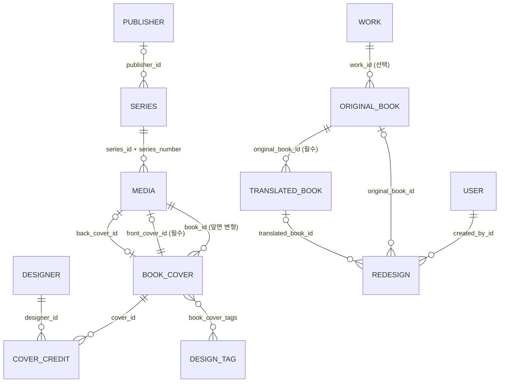

# 데이터 모델

엔티티·관계·제약과 ES 문서 구조. 엔티티는 `src/main/java/com/bookcover/archive/domain/<영역>/`. 스키마 변경 절차는 [DEVELOPMENT.md](DEVELOPMENT.md#엔티티-필드테이블-변경-스키마-변경).

## 관계도

`MEDIA`는 `ORIGINAL_BOOK`·`TRANSLATED_BOOK`의 공통 부모(JOINED 상속)다. 좋아요·댓글·컬렉션·신고는 FK 없이 `(target_type, target_id)`로 가리킨다(아래 [다형 대상](#다형-대상-fk-없음)).

## 책

### Media (추상, `media`) — `domain/media/Media.java`
- JOINED 상속, 판별 컬럼 `media_type` = `BOOK_ORIGINAL` | `BOOK_TRANSLATED`. 하위 테이블 `original_books`, `translated_books`가 `media.id`를 PK로 공유.
- 공통 필드: `title`(필수), `languageCode`(필수, 2자), `countryCode`·`year`(선택), `status`(`ContentStatus`, 기본 PUBLISHED), `series` + `seriesNumber`, `createdBy`.
- `covers`: 같은 `book_id`를 가진 앞면 표지 변형 목록(`usedFrom`, `createdAt` 순). 뒷면은 들어가지 않는다.
- `isPublic()` = `status == PUBLISHED`. 공개 조회 경로는 이 메서드로 거른다.

### OriginalBook (`original_books`)
- `originalTitle`(필수), `genre`(선택), `isbn`(이 테이블 안에서만 unique), `edition`(판 정보 자유 텍스트), `author`, `publisher`, `work`.
- `translations`: cascade ALL, orphanRemoval 없음.
- `frontCover`: OneToOne 필수(`front_cover_id` not null), cascade ALL. `backCover`: 선택, orphanRemoval.

### TranslatedBook (`translated_books`)
- `originalBook`(필수), `author`, `translator`, `publisher`, `isbn`(unique), `edition`, 앞/뒤 표지는 원서와 같은 매핑.
- **Work 필드가 없다.** 작품 묶음은 `originalBook.work`로만 닿는다.

### Work (`works`)
- 같은 작품의 다른 출판사·판 원서들을 묶는다. `title`(필수), `originalTitle`, `description`. 역참조 컬렉션 없음.
- 관리자 관계 수정 API(`JOIN_WORK`/`LEAVE_WORK`)로 바뀐다.

### Series (`series`)
- `name`(필수) + `publisher`(선택). 같은 이름이라도 출판사가 다르면 다른 시리즈로 취급하지만 **(name, publisher_id) unique 제약은 없다**(`BookServiceImpl`의 `ponytail:` 주석 참고).

### ContentStatus
`DRAFT`(관리자만 원서로 생성, 공개 경로 미노출) · `PUBLISHED` · `HIDDEN`(신고 자동 숨김·모더레이션·테이크다운) · `DELETED`(소프트 삭제). 책·리디자인·댓글에 쓰인다. **표지는 ContentStatus가 아니라 `hidden` boolean**을 쓴다.

## 표지

### BookCover (`book_covers`) — `domain/book/BookCover.java`

| 필드 | 의미 |
|---|---|
| `imageUrl`, `thumbnailUrl`, `originalFileName`, `width`, `height`, `fileSize` | 업로드 결과. URL은 `image_assets`에 검증 기록이 있어야 저장 가능 |
| `coverType` | `FRONT` / `BACK` |
| `book` (`book_id`) | 소속 책. 앞면(대표+변형)은 채워지고, **뒷면은 null** → 뒷면의 책은 `findByBackCoverId`로 찾는다 |
| `label`, `printingFrom`, `usedFrom` | 변형 설명("10쇄 리커버"), 적용 시작 쇄·날짜 |
| `variantType` | `UNKNOWN/INITIAL/RECOVER/SPECIAL/PRINTING/IMAGE_REPLACEMENT`. 한 판(edition) 안의 변형. NULL이면 getter가 UNKNOWN |
| `ribbonStatus` | 띠지 `UNKNOWN/CLEAN/BANDED`. NULL이면 UNKNOWN |
| `copyrightHolder` | 표지 저작권자(500자). setter가 trim, 공백이면 null |
| `sourceName`, `sourceUrl`, `imageSource` | 이미지 제공처("Open Library"), 출처 URL(1000자), `SCAN/PHOTO/LINK/OTHER` |
| `similarGroupId` | 언어가 달라도 디자인이 비슷한 표지끼리 같은 UUID. 그룹 테이블 없음. ES에 색인 안 됨 |
| `countryCode`, `languageCode` | null이면 책 값을 상속 |
| `hidden` | 테이크다운 숨김 |
| `likeCount`, `commentCount` | 비정규화 카운터(원자적 UPDATE, 0 미만 방지) |
| `credits` | `CoverCredit` 목록(cascade ALL, orphanRemoval) |
| `tags` | `DesignTag` M:N (`book_cover_tags`) |
| `dominantColor`, `layout` | 컬럼은 있으나 현재 채우는 코드가 없다 |

- 대표 앞면 = 책의 `front_cover_id`. 변형 = 같은 `book_id`의 다른 행. 대표 교체는 `PUT /books/{id}/covers/{coverId}/representative`.
- **크레딧은 책이 아니라 표지에 있다**(리커버 디자이너가 다를 수 있음). 옛 책 단위 `designer_id`는 `2026-10-14_*` 마이그레이션으로 제거됨.

### CoverCredit (`cover_credits`)
- `(cover_id, designer_id, role)` unique. `role` = `DESIGN/ART_DIRECTION/ILLUSTRATION/PHOTOGRAPHY/LETTERING`. 일러스트레이터·사진가도 `Designer`.
- 생성 후 불변(setter 없음). 수정은 `BookServiceImpl.applyCredits`가 **diff**로 추가/삭제한다(전체 삭제 후 재삽입하면 flush 순서 때문에 unique 위반이 난다).

### ImageAsset (`image_assets`) — 업로드 검증·차단 기록
- 업로드에 성공한 모든 이미지 1행(`imageUrl` unique). 표지·리디자인 저장 시 `requireVerifiedImage`가 이 기록과 URL·타입·썸네일·크기를 대조한다. 표지와 FK가 아니라 URL 문자열로 연결된다.
- 해시 세 종류 — 의미를 섞지 말 것:

| 컬럼 | 대상 | 용도 |
|---|---|---|
| `sha256` | sRGB 변환 후 **픽셀** | 테이크다운 차단·재업로드 거절 (`blocked=true` 부분 인덱스) |
| `file_sha256` | 저장된(재인코딩된) **파일 바이트** | 동일 파일 탐지(`EXACT_FILE`) |
| `perceptual_hash` | 64비트 dHash(16 hex) | 유사 후보(`SIMILAR`). 사람이 검토, 자동 병합 금지 |

- `type` = `COVER/REDESIGN/PROFILE`(`ImageService.ImageType`), `blocked`.

### Redesign (`redesigns`)
- `imageUrl`, `thumbnailUrl`, `description`(필수, 2000), `status`, 카운터, `createdBy`(필수).
- `originalBook`/`translatedBook` 중 하나 이상 필수(`@PrePersist` 검사). 둘 다 있어도 막지 않는다.

## 기여자

`Author`(`authors`), `Designer`(`designers`), `Publisher`(`publishers`), `Translator`(`translators`) — 각자 별칭 테이블(`*_aliases`, `@ElementCollection`). **이름 unique 제약 없음** → 동시 등록 시 중복 행이 생길 수 있고, 조회는 첫 행을 쓴다. 중복은 관리자 병합(`EntityManagementServiceImpl`, Author/Publisher/Designer만, Translator는 병합 없음)으로 정리한다.

## 소셜·컬렉션

### 다형 대상 (FK 없음)

| 엔티티 / 테이블 | 대상 enum | 제약 |
|---|---|---|
| `Like` / `likes` | `LikeTargetType`: `ORIGINAL_COVER, TRANSLATED_COVER, REDESIGN` | `(user_id, target_type, target_id)` unique |
| `Comment` / `comments` | `CommentTargetType`: 위와 같음 | `content` 1000자 |
| `CollectionItem` / `collection_items` | `CollectionItemType` (`item_type`, `item_id`): 위와 같음 | 중복 방지 제약 없음 |
| `Report` / `reports` | `ReportTargetType`: `ORIGINAL_BOOK, TRANSLATED_BOOK, REDESIGN, COMMENT` | `ReportReason`: INAPPROPRIATE/COPYRIGHT/SPAM/WRONG_INFO/OTHER |

- DB가 대상 존재를 보장하지 않으므로 서비스가 확인한다(`SocialServiceImpl`의 `validate*TargetExists`, `ModerationServiceImpl.validateTargetExists`). 좋아요·댓글 대상 검사는 존재만 보고 상태(HIDDEN/DELETED)는 보지 않는다.
- 이름 차이 주의: 소셜은 `*_COVER`, 신고는 `*_BOOK`.

### Collection (`collections`)
- `owner`, `name`(100), `description`(500), `visibility`(`PRIVATE/PUBLIC/LINK_ONLY`, 기본 PRIVATE), `shareToken`(unique, 생성 시 UUID), `items`(cascade, orphanRemoval).

## 사용자·운영

- **User** (`users`): `email` unique, `passwordHash`, `displayName`, `role`(`PUBLISHER/AUTHOR/DESIGNER/MEMBER/ADMIN`), `status`(`ACTIVE/SUSPENDED/DELETED`), `suspendedUntil`, `reportRestricted`, `title`(`MEMBER/CONTRIBUTOR`), `contributionCount`, SNS 계정(`user_sns_accounts`).
  - 탈퇴 = 익명화: 이메일 → `deleted-{id}@deleted.invalid`, 프로필 삭제, `DELETED`. 콘텐츠는 남는다.
  - `contributionCount`는 공개 원서·번역서·리디자인 등록과 **표지 변형 추가**마다 +1, 10 이상인 MEMBER는 CONTRIBUTOR. 감소해도 칭호는 유지(`ContributionServiceImpl`).
- **AuditLog** (`audit_logs`): `action`(`CREATE/UPDATE/DELETE/MERGE/SPLIT/STATUS_CHANGE`), `entityType`(`ORIGINAL_BOOK/TRANSLATED_BOOK/REDESIGN/USER/COLLECTION/AUTHOR/PUBLISHER/DESIGNER`), `entityId`(FK 없음), `previousValue`/`newValue`(jsonb), `performedBy`(필수). 표지 단위 타입이 없어 표지 변경은 소속 책 이력으로 남긴다. 작성처는 [ARCHITECTURE.md#감사-로그](../ARCHITECTURE.md#감사-로그).
- **DesignTag** (`design_tags`): `name` unique, `category`(`STYLE/COLOR/LAYOUT/TYPOGRAPHY/ILLUSTRATION`), `usageCount`, `approved`.
- **TakedownRequest** (`takedown_requests`): 요청자 이름·이메일, `targetUrl`, `targetId`(선택, FK 없음), `reason`, 증빙, `status`(`PENDING/APPROVED/REJECTED`), 검토 정보. `preventReupload` 필드는 레거시(재업로드 차단은 `image_assets.sha256`으로 한다).
- **ContentOutboxEvent** (`content_outbox_events`, `event/ContentOutboxEvent.java`): Kafka로 보낼 콘텐츠 이벤트. `publishedAt IS NULL`이 미발행. 발행된 행은 지우지 않는다.

## 스키마 관리 주의

- 마이그레이션 도구가 없다. prod `ddl-auto: validate`는 테이블·컬럼·타입만 본다(인덱스·CHECK·unique는 검사하지 않음).
- `scripts/migrations/`에만 있고 엔티티에 선언되지 않은 것들 — **dev DB(ddl-auto=update)에는 없다**:
  - `cover_credits.role` CHECK, `book_cover_tags`의 `ON DELETE CASCADE`와 `tag_id` 인덱스
  - 부분 인덱스: `idx_content_outbox_pending`, `idx_book_covers_similar_group_id`, `idx_image_assets_blocked_sha256`, `idx_image_assets_file_sha256`
  - DB 기본값 `blocked DEFAULT false`, `hidden DEFAULT false`
- 기본 테이블(users, media, book_covers …)을 만드는 스크립트는 없다. 마이그레이션은 2026-10-14 이후의 증분만 담고 있다.

## Elasticsearch 문서 (`book_covers` 인덱스)

`search/document/BookCoverDocument.java` + `src/main/resources/elasticsearch/book-covers-settings.json`.

- 문서 ID: `original_{id}`, `translated_{id}`, `redesign_{id}`. `type` = `ORIGINAL/TRANSLATED/REDESIGN`.
- 한국어 분석(`korean_analyzer` = nori + edge_ngram 1–10): `title`, `author`, `publisher`, `designers`, `description`, `creatorName`. 검색 분석기도 같은 `korean_analyzer`를 쓴다(`korean_search_analyzer`는 정의만 있고 미사용).
- `originalTitle`은 standard 분석기.
- keyword: `authorId`, `publisherId`, `designerIds`, `isbn`, `countryCode`, `languageCode`, `genre`, `tags`, `tagIds`, `status`, `creatorId`. 숫자/날짜: `year`, `likeCount`(대표 앞면 기준), `createdAt`. `thumbnailUrl`은 index=false.
- `designers`/`designerIds`는 앞면 변형·뒷면의 모든 크레딧(역할 무관). `tags`는 숨김이 아닌 표지의 승인된 태그만.
- 색인 안 되는 것: `similarGroupId`, `variantType`, `ribbonStatus`, `copyrightHolder`, `hidden`, 시리즈.
- 인덱스에는 **모든 상태**의 문서가 있다. 공개 여부는 쿼리의 `status=PUBLISHED` 필터로만 결정된다.
